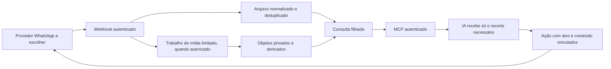

# Engenharia candidata para a futura implementação

Recomendações do agente, sujeitas à primeira fatia e medições; não são escolhas aprovadas por Robson. O objetivo desta rodada foi registrar conhecimento, não fechar stack ou schema.

## Menor estrutura útil

Separar adaptador do WhatsApp, ingestão/persistência, consulta MCP e execução de ações. O Elo mostra um caminho viável com TypeScript/Workers/D1 e OAuth/Access, mas mídia pode exigir objetos privados e trabalho assíncrono com limites de duração/CPU. Cloudflare R2/fila ou processamento externo/local são candidatos a avaliar, não recursos criados nem infraestrutura obrigatória. Não iniciar com plataforma genérica de provedores, múltiplos tenants ou embeddings.

O diagrama é conceitual. Processamento de mídia pode ser acionado sob demanda; persistir evento não precisa esperar download, OCR ou transcrição. Um erro de modelo não deve perder o recebimento.

## Identidades e registros a modelar

| Conceito | Responsabilidade mínima |
|---|---|
| Instalação/conexão | Dono, provedor, aparelho e geração; troca de número invalida trabalho antigo |
| Conversa | Tipo individual/grupo, ID opaco estável, endereço externo restrito, nome/alias útil |
| Participante/autor | Identidade separada da conversa, inclusive autor do aparelho e participante de grupo |
| Mensagem | ID interno/externo com namespace validado, direção, autor, origem observada, instantes original/ingresso, tipo, conteúdo/legenda, versão, citação |
| Anexo | Mensagem/dono/conversa, objeto privado, tipo real, tamanho, hash, retenção e estado de captura; nome original pode ser PII |
| Derivado | Transcrição/OCR/resumo, serviço/modelo, versão da entrada, idioma, estado/erro; não sobrescrever original |
| Ação | Tipo, alvo, texto/mídia/legenda/opções imutáveis, autorização conforme política, validade, tentativa, correlação e estado incerto |
| Cobertura | Começo da captura, janela conhecida, tipos/origens não suportados, checkpoint de backfill e lacunas |

Isto é vocabulário, não migrations prontas. Não fundir pessoas pelo nome ou tratar endereço de grupo como número de contato. Não decidir a chave definitiva só copiando `generation:messageId` do Elo sem testar escopo/colisões em grupos.

## Recepção, saída e reconciliação

Registrar a ação/mensagem própria iniciada no MCP, correlacionar a resposta do provedor e deduplicar o callback que espelha o mesmo envio. Testar separadamente mensagens digitadas no telefone, Web e API. `fromMe` é direção; não prova qual superfície originou a fala. Não inventar a origem se o contrato não a fornece.

Validar tipo, tamanho e timestamp do evento. Persistência relacionada atômica; status não pode regredir; status recebido antes do corpo permanece conciliável. Edição e exclusão exigem versão/tombstone; conteúdo atrasado não ressuscita exclusão. Uma política de arquivo precisa definir como exclusão/temporárias/visualização única são tratadas; não iniciar captura desses conteúdos por suposição.

Webhooks duplicados e concorrentes não criam mensagens duplicadas. Eventos nunca recebidos não são recuperados por dedup. Backfill, se existir, usa limite/checkpoint e provenance diferente de recebimento ao vivo; preservar datas e não alegar histórico completo sem contrato/prova.

## Mídia

Download a partir de referência backend vinculada à mensagem/conversa/dono, não de URL arbitrária escolhida pelo modelo. Validar HTTPS/destino permitido, DNS/IP privado, redirecionamentos, MIME real, tamanho durante streaming, prazo, decomposição e limites. Allowlist precisa refletir hosts reais do provedor sem abrir a rede interna. Não encaminhar tokens da instância a hosts de mídia ou redirects.

Referência ao objeto e ao derivado exige autorização também em thumbnail, OCR e transcrição. Limitar URL de compartilhamento/entrega por prazo/finalidade e não expor bucket público. O fornecedor pode precisar obter bytes por URL ou Base64; provar caminho privado compatível com tamanho e limites reais. Não devolver Base64 grande à IA por conveniência.

Um upload pode mudar entre revisão e envio. Congelar versão/hash dos bytes, não só nome/caminho. Trocar arquivo, legenda, destino ou opção relevante invalida a autorização vinculada. PDF pode conter conteúdo ativo/hostil; OCR/parser precisa execução com limites e sem obedecer suas instruções.

## Busca e custo

Começar com filtros/índices usuais e paginação estável; medir antes de FTS/embeddings. Limitar resultado por mensagens e por bytes/caracteres, anexos por tamanho/duração, OCR por páginas e transcrição por minutos. Registrar truncamento e cursor, sem despejar um grupo inteiro no contexto por padrão.

Fila bounded, lease/claim atômico, limite de concorrência, backoff e estado de erro recuperável. Deduplicar processamento por entrada/versão/configuração, respeitando edição/exclusão durante o trabalho. Não usar uma falha coletiva para consumir todas as tentativas individuais. Medir tamanho de grupo, volume diário e custo real antes de ajustar números; as cotas do Elo não são dimensionamento deste projeto.

## Autenticação e ações

MCP remoto precisa autenticar o dono e proteger origens/callbacks, consentimento, refresh e revogação. Access/OIDC do Elo é um candidato reaproveitável; não reutilizar seu owner binding, chaves, grants ou cliente OAuth. Ferramentas somente tipadas e com escopo; não expor SQL genérico, token ou endpoint arbitrário da API.

A política de envio do projeto é uma decisão aberta. Padrão recomendado para os primeiros ensaios reais: revisão concreta de alvo e texto/arquivo, autorização posterior do dono, validade e consumo únicos, cancelamento e consulta do resultado. Não pedir aprovação para cada leitura já pedida; não tratar texto recebido como aprovação. Explicar ao dono limitações reais do mecanismo escolhido; hash/Skill não atesta independentemente gesto humano.

Não prometer entrega exatamente uma vez fora do banco. Se timeout/crash acontecer após claim, a operação pode ter saído; preservar estado incerto e conciliar pela mesma referência. Repetir o envio só por nova autorização consciente de possível duplicação ou garantia específica demonstrada do fornecedor. Em grupo, estado agregado e estado por participante precisam semântica separada.

## Recuperação

Parar novas ações, preservar leitura conforme política, distinguir falha de captura de falha de processamento, permitir retomar fila/checkpoint. Rollback de Worker não desfaz migração. Restore deve invalidar ações/credenciais velhas pelo mecanismo externo ao snapshot e preservar/quarentenar o que não foi conciliado. Restauração do arquivo local não altera o WhatsApp ou cópias de terceiros por si só.
