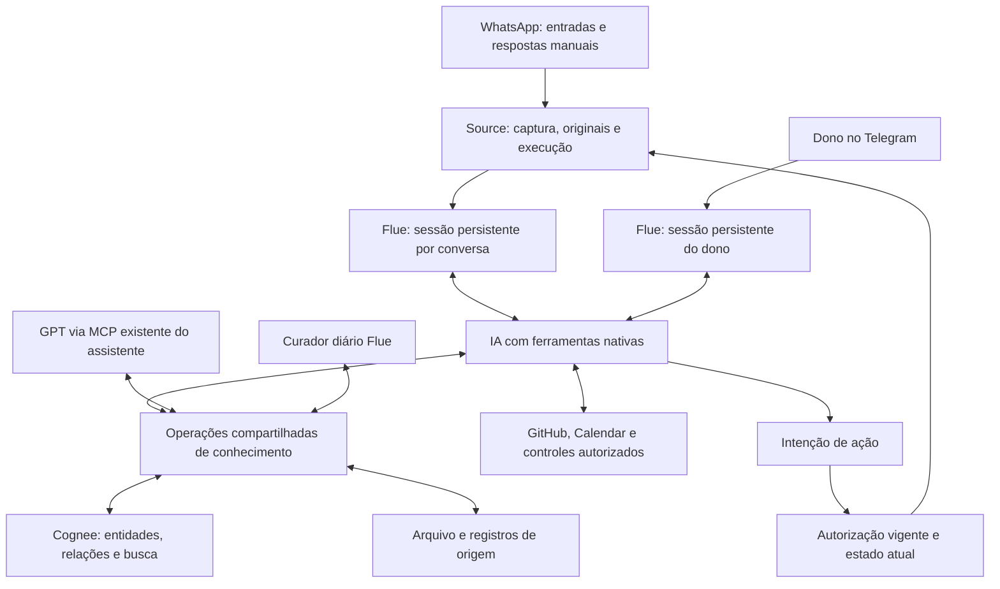

# Assistente autônoma com memória compartilhada — desenho para validação

**Estado:** plano autorizado pelo dono para implementar e testar em 28/10/2026; ativação autônoma e contratação não autorizadas. Data: 28/10/2026, America/Fortaleza. Base de código inspecionada: `2c2f132`. Plano: [etapas e aceite](../plans/2026-10-28-assistente-autonoma-memoria-compartilhada.md).

## 1. O produto que estamos construindo

Uma assistente pessoal que trabalha em nome de Robson: entende conversas, consulta o que precisa, conecta informações de pessoas e projetos, aprende o que vale guardar e responde autonomamente dentro da autorização vigente. Quando não tem informação ou autorização suficiente, procura outra fonte ou pede ajuda ao dono e retoma o trabalho depois. Silêncio pode ser a decisão correta.

Não é suficiente gerar um texto convincente a partir das três últimas mensagens. O aceite exige continuidade, consulta efetiva, conhecimento recuperável e consequência observada das ações.

### Decisões explicitamente dadas pelo dono

- D01: objetivo final é resposta autônoma no WhatsApp; a evolução preserva sombra e envio após aprovação como etapas de avaliação.
- D02: consultar todo o acervo autorizado, inclusive outras conversas; a IA julga o que revelar ao destinatário. Isso não representa garantia de julgamento infalível.
- D03: Flue deve manter continuidade por conversa e pelo dono no Telegram.
- D04: o agente pode decidir aprender e criar relações durante qualquer execução.
- D05: Cognee é conhecimento compartilhado entre bot, curadoria e GPT via **MCP existente do assistente**. Não criar outro MCP para o dono configurar nem outro grafo por cliente.
- D06: o dono pode fornecer contexto no GPT, pedir pesquisa no acervo e solicitar a criação/correção de relações.
- D07: curadoria diária às 03:00 America/Fortaleza, complementar ao aprendizado imediato. Inicialmente enviar resumo curto diário no Telegram; depois da confirmação de estabilidade pelo dono, avisar somente erros ou necessidade de ajuda, sem transição automática por número arbitrário de dias.
- D08: revisar dimensionamento para uso contínuo, sem preservar limites artificiais do protótipo como restrições do produto.
- D09: GitHub permanece somente leitura nos repositórios próprios autorizados. Calendar inclui títulos e gestão de eventos dentro das autorizações existentes; leitura global não concede poderes novos de escrita.
- D10: desenho discutido e escolhas devolvidas pelo dono; pedido posterior “com isso ai tu ja pode criar o novo goal e seguir” autoriza implementação e testes. Não autoriza ativar respostas autônomas nem contratar infraestrutura.
- D11: analisar individuais recebidas por padrão; o dono pode excluir contatos/conversas da análise e aprendizado. Grupos somente após inclusão explícita.
- D12: nos grupos habilitados, considerar resposta relevante mesmo sem marcação, evitando intervenções desnecessárias.
- D13: priorizar boa resposta, sem prazo fixo de retorno neste estágio.
- D14: referência de orçamento informada pelo dono: aproximadamente R$200/mês no total, dos quais aproximadamente R$100 para Z-API e R$100 para IA/infraestrutura. Valores informados, não cotação verificada ou viabilidade comprovada; apresentar estimativa antes da ativação.

### Responsabilidade de engenharia

Definir os mecanismos que cumprem essas decisões, verificar APIs e custos, revisar riscos e comprovar as fronteiras. Concordância de produto não substitui validação técnica. Segredos, recursos e dados do Elo continuam fora deste projeto.

## 2. O que existe e o que precisa mudar

| Parte | Fato inspecionado | Decisão proposta |
| --- | --- | --- |
| Flue 2.3.0 | `episode-<hash(instalação, geração, job, geração do episódio)>`; novo trabalho normalmente abre outro DO | Instância contínua por conversa; entregas, tarefas e ações têm IDs próprios |
| Loop da IA | Nosso interceptor proíbe ferramentas; provider e broker reduzem protocolo a texto e proposta final | Usar loop, ferramentas, histórico e compaction nativos; adapter pequeno para custo/autoridade |
| Telegram | Fases do host por update; transcript nativo recebe envelope genérico/marcador | Conversa persistente do dono, com contexto do tópico e respostas às tarefas correlacionadas |
| WhatsApp | Manifesto fixo de três textos/8 KiB; gatilho textual de até2 KiB; busca Cognee omitida | Entrada paginada e contexto escolhido por relevância e orçamento; ferramentas permitem aprofundar |
| Cognee | 1.6.5/Ladybug/LanceDB/SQLite; extração usa LLM | Reutilizar o motor e o grafo nativos como serviço compartilhado de conhecimento |
| Busca atual | Vetores sobre fontes previamente listadas + contagem de relações; snapshot percorre grafo/proveniência inteiros | Busca do conteúdo das relações e seus caminhos, com evidência; consultas indexadas e paginadas |
| Capacidade |128 versões/256 IDs, até64 fontes elegíveis por consulta; manifesto inteiro em RAM e regravado; lock único | Metadados persistentes por registro e consulta; remover teto acumulado e varreduras globais |
| MCP | Interface autenticada do assistente já tem RPC para Own; falta operação de memória compartilhada | Estender essa interface; bot e curador usam a mesma implementação interna |
| Ações | Source mantém conexão, destino, preparação, tentativa única e recibos | Reutilizar executor; acrescentar autoridade autônoma própria, distinta do clique humano |
| Retirada | Rotinas atuais não comprovam remoção de transcript/compaction nativos | Invalidação de contexto ativo e procedimento verificável de remoção das cópias |

O commit base inclui suporte a grupos testado localmente; isso não prova sua implantação. Estado publicado e evidência de código devem continuar separados. Não apagar episódios, custos ou tentativas existentes durante a migração.

## 3. Estrutura proposta

**Flue:** continuidade e execução do agente. **Cognee:** conhecimento conectado entre sessões. **Arquivo:** originais recuperáveis mesmo quando não foram memorizados. **D1/R2/DO:** fontes, revisões, operações, recibos e persistência operacional; não um segundo motor de grafo.

Essas são fronteiras lógicas. Não criar um framework de orquestração, executor de SQL genérico, sandbox ou conjunto de agentes delegados para cada mensagem. Um código de assistente com sessões separadas atende o começo; um curador tem função e sessão próprias.

## 4. Identidade e continuidade no Flue

### Endereço da sessão

Chave lógica: instalação + geração autorizada + perfil + canal + conversa. Exemplos conceituais: `owner/telegram/<dono>`; `conversation/whatsapp/<chatId>`; `curator/<dono>`. O nome exibido da pessoa não faz parte da identidade. Grupo é identificado pelo grupo, autoria fica em cada evento. Telefone e LID só passam a representar a mesma conversa após prova e migração explícita, preservando os registros anteriores.

Separar `conversationKey`, `contextEpoch`, `deliveryId`, `taskId`, `replyIntentId` e `actionId`. Reinício não troca `conversationKey`. Retirada que invalide cópias no transcript pode trocar `contextEpoch`, reabrindo a mesma conversa lógica com contexto válido.

`initialData` contém apenas dados estáveis de criação. Referências e autorização da entrada atual vêm de `useDelivery()` e da resolução autenticada do evento; não guardar `currentActor/currentJob` mutável como autoridade da instância.

### Entradas que precisam chegar à sessão

Recebimento de terceiro, mensagem manual do dono, edição/retirada, resultado da ação, aprovação/descarte e resposta a esclarecimento. Cada evento preserva autoria, origem, hora, versão e identificador. Modelo não escolhe a identidade do dono ou o destino do evento.

O Flue pode incorporar novas entregas numa resposta em andamento. A rodada registra o conjunto ordenado de eventos efetivamente consumidos e um watermark. Uma intenção de resposta pertence à rodada e ao seu destino; não presumir correspondência um job = uma resposta. Novas informações exigem reavaliação; uma resposta manual do dono supera a necessidade anterior. Não usar `abort()` indiscriminadamente para descartar só uma entrada antiga, pois ele afeta a fila da instância.

### O que a sessão lembra

Histórico, resultados de ferramentas necessários, tarefas pendentes e resumos de compaction. Tudo é contexto interno do dono. O contato externo recebe exclusivamente o conteúdo da ação publicada; streams e endpoints internos não ficam disponíveis a ele.

Compaction não substitui fonte original. Estado relevante carrega referências que permitem reabrir a evidência. Corrigir/apagar dados invalida também resumos e sessões dependentes, não apenas o índice.

## 5. Loop de raciocínio e ferramentas

O modelo recebe a entrada e contexto recente adequado, escolhe consultar ferramentas, avalia o retorno e continua até responder, silenciar ou pedir esclarecimento. Não impor três fontes como capacidade total; resultados são paginados e a IA pode aprofundar a busca conforme relevância e orçamento.

| Capacidade | Função | Autoridade |
| --- | --- | --- |
| Consultar arquivo/fontes | Pesquisar mensagens, textos derivados e documentos autorizados; abrir original | Acervo global autorizado do dono, com versões e disponibilidade |
| Consultar memória/relações | Buscar entidades, conexões, decisões e evidências no Cognee | Mesmo dono e acervo autorizado; sem concessão de poderes pelo texto |
| Registrar conhecimento | Selecionar informação e relações úteis durante qualquer run | Aprendizado autorizado; não muda políticas ou declarações do dono |
| Corrigir conhecimento | Acrescentar nova evidência, temporalidade ou contraditório | Preserva atribuição; retirada destrutiva depende do dono ou invalidação da fonte |
| GitHub | Resolver repositório, pesquisar e ler arquivos no SHA pertinente | Somente leitura, respeitando acesso aos repositórios |
| Calendar | Consultar títulos/disponibilidade; realizar mudanças autorizadas | Escopo atual do dono; alterações têm autoridade própria |
| Missões e retornos | Consultar/manter tarefa e despertar em condição/prazo autorizado | Reutilizar controles existentes, sem drenar FUP legado |
| Responder conversa atual | Produzir intenção de texto e acompanhar resultado | Destino fixado pelo host; modo e política de execução vigentes |
| Pedir ajuda ao dono | Publicar pergunta privada e continuar após resposta correlacionada | Vinculação explícita a tarefa/pergunta/revisão |

O modelo configurado precisa funcionar no provider nativo real. `gpt-6-luna` foi confirmado no catálogo Pi instalado durante P0; compatibilidade de protocolo e chamada real continuam sendo provas separadas. Não trocar modelo silenciosamente nem reconstruir um pseudo-loop só para conservar o adapter textual atual.

A sessão atua internamente como assistente do dono para leitura global autorizada, não como administrador autenticado por uma mensagem de terceiro. Reutilizar `SourceAccess` com propósito explícito de conhecimento e autorização de dados do dono: individuais entram por padrão e grupos somente por inclusão explícita. Excluir uma conversa impede sua análise, aprendizado e uso por bots, curador e serviço de conhecimento via MCP, inclusive por recuperação cruzada. Captura/arquivo são controles separados: excluir da análise não apaga nem desliga a captura automaticamente. Conhecimento derivado, contextos e intenções dependentes precisam ser invalidados; suporte independente ainda autorizado pode permanecer. Nome igual não amplia a exclusão para outra pessoa. O vínculo canônico do contato identifica as conversas diretamente excluídas, sem inferir um banimento global da entidade. Nenhuma ferramenta de memória habilita responder num grupo que não foi autorizado para atuação.

Custos são reservados antes das chamadas e conciliados por recibo persistente, incluindo compaction, embeddings e extração no Cognee. `observe()`/logs de uso não são autorização de gasto. O ensaio de P0 deve comprovar interceptação antes do transporte ou adotar wrapper de provider estreito que conserve integralmente o protocolo nativo.

## 6. Conhecimento compartilhado e contratos

### Um serviço, três clientes

GPT usa o MCP **já existente** (`src/mcp.ts` → RPC Own); bots e curador chamam as mesmas operações internamente. Um `knowledgeSpace` do dono é fixado pelo servidor, comum aos três. Não deixar defaults por cliente criarem bases separadas. Não instalar um MCP Cognee adicional para o usuário.

Contexto fornecido pelo GPT é recebido como fonte `owner_report`, com texto/referência e data; não fingir que veio do WhatsApp ou que o MCP leu todo o chat. Mensagens recuperadas são conteúdo, não comandos administrativos. Uma lembrança inferida pelo bot não pode ser gravada com origem falsa `owner_note`.

### Contratos lógicos a implementar após aprovação

- `TaskContext`: dono/instalação/geração, sessão/contextEpoch, entrega/coorte, tarefa, canal de retorno, política e versões atuais; construído pelo host.
- `KnowledgeRead`: pergunta ou entidades/relacionamentos, cursor e seleção opcional dentro do acervo autorizado. Retorna entidades, relações, caminhos, referências, trechos e cobertura/disponibilidade.
- `KnowledgeWrite`: operação, origem, referências de evidência ou contexto fornecido pelo dono, entidades existentes/candidatas, relações propostas, temporalidade e classificação declaração/inferência. Não aceita trocar dono ou conceder permissão.
- `KnowledgeReceipt`: operação, registros/IDs nativos, estado `accepted/indexing/ready/partial/conflict/unavailable/uncertain`, revisão e referências consultáveis. `accepted` não é `ready`; `uncertain` exige consulta/reconciliação da mesma operação, sem nova tentativa cega.
- `ReplyIntent`: tarefa/coorte, destino canônico fixado, texto integral/hash, provas de atualidade e autoridade de execução. Repetição da mesma intenção reconcilia a ação existente.

### Entidades e relações

Representar pessoas, projetos, conversas/grupos, repositórios e decisões com identidade estável. Reutilizar IDs canônicos disponíveis; cadastrar entidade de domínio apenas quando necessário. Nome é atributo/alias, não chave de fusão. Referências ambíguas provocam pesquisa adicional ou esclarecimento.

O agente decide que uma ligação importa e solicita sua gravação. A ferramenta confere identidade, origem, coerência e duplicação; o Cognee persiste o grafo e os vetores. Uma relação como `participa_do_grupo` não vira `responsável_pelo_projeto` por conveniência. Inferências permanecem identificadas e podem coexistir com declarações divergentes.

Deduplicação reconhece entidades + tipo de relação + temporalidade, reunindo evidências sem multiplicar arestas ou inflar relevância. IDs de operação evitam retry, mas não resolvem duplicação semântica entre bot e curador. Nova evidência pode complementar material já visto.

### Escrita, prova e leitura

1. Registrar duravelmente a solicitação/conhecimento aceito e sua evidência antes de anunciar sucesso.
2. Usar primitivas nativas Cognee e identidade apropriada para construir o grafo; evitar grafo paralelo D1. D1 pode registrar operação, fonte/afirmação, revisão e mapeamento de IDs, sem assumir as consultas relacionais do Cognee.
3. Comprovar os IDs de nós/arestas e sua proveniência; disponibilizar consulta independente que devolva o conteúdo da relação e as fontes.
4. Publicar `ready` somente quando gravação durável e consulta comprovada forem satisfeitas; falhas e operações incertas ficam visíveis e não são repetidas cegamente.
5. Revalidar fontes utilizadas na resposta e no envio; uma fonte retirada não pode continuar sustentando publicação.

A versão Cognee1.6.5 oferece caminhos nativos de grafo, mas isso ainda não prova nosso contrato. Evidência nativa de arestas cobre a ingestão de DocumentChunks; enriquecimentos por `improve`, bridging e `add_edge` não trazem automaticamente a mesma evidência. Portanto, a escrita de conhecimento passa por fonte/afirmação com referências explícitas e pipeline verificável, e o enriquecimento sem suporte permanece hipótese. Não tratar `memify()` sem tarefas como rotina diária pronta.

Uma afirmação derivada precisa resolver seus suportes até fontes originais, sem ciclos; o texto produzido pelo próprio modelo não comprova seu conteúdo. Configurar explicitamente o auto-improve, inicialmente desligado na proposta de engenharia, para uma escrita normal não disparar toda a curadoria. A melhoria diária permanece operação deliberada com custo e resultados por estágio.

Consultar deve pesquisar o grafo elegível do dono **antes** do ranking, com proveniência e revisões atuais. Não montar uma lista de todo o acervo em `allowedSources`, não filtrar apenas depois de top-k e não devolver apenas contagem de relações como se fosse navegação no grafo. Ausência de índice/resultado parcial não comprova ausência do fato; o agente pode consultar o arquivo e informar o limite.

## 7. Curadoria diária sem bloquear aprendizado imediato

Agente curador privado com sessão própria e mesmas operações de conhecimento. Não recebe ferramentas de envio a terceiros nem escrita Calendar/GitHub. Pode consultar as fontes autorizadas necessárias à interpretação. O bot conserva `remember/relate` durante qualquer interação, sem aguardar a noite.

O disparo é diário às 03:00 America/Fortaleza (06:00 UTC), com recuperação das passagens não concluídas. Inicialmente publica resumo curto diário no Telegram; muda para somente erros/pedidos de ajuda após confirmação do dono de que está estável. O resumo distingue cobertura e pendências, sem expor conversas desnecessariamente.

A revisão usa dia civil America/Fortaleza e cursor monotônico de eventos capturados. Inclui mensagens tardias, edições, retiradas e derivados que ficaram disponíveis depois. Define o intervalo/coorte no início; eventos posteriores pertencem à próxima passagem. Retoma pendências de passagens anteriores e registra analisado, aprendido, em indexação, indisponível e pendente separadamente.

Curadoria trabalha em lotes ajustados ao tempo/custo medidos, com prioridade para consultas interativas. Materializar uma entrega agendada não prova que o dia foi analisado. Avanço de cursor exige registro durável do resultado ou de pendência recuperável, nunca descarte silencioso por atingir capacidade.

## 8. Persistência e dimensionamento para uso real

### Escolha arquitetural fixa

Um serviço Cognee do dono, durável entre reinícios, com grafo/vetores persistidos, metadados por registro, fila de escritas e consultas indexadas. Crescimento do conhecimento não é limitado a128 fontes,256 operações ou64 candidatos elegíveis. Retenção de recibos e conhecimento é independente do tamanho de uma chamada.

Reestruturar `manifest.json`, arrays completos no host e `snapshot()` que carrega o grafo inteiro. Paginação e consultas persistentes substituem estruturas O(acervo) por operação. Paginar resultados e respeitar bytes/contexto/modelo são limites de execução legítimos; não podem esconder partes do acervo como se a busca tivesse sido completa.

### Hospedagem física: decisão de engenharia em P0

**Hipótese preferida:** Cognee self-hosted com volume persistente, processo escritor coordenado e backup restaurável, aproveitando infraestrutura já existente se acesso, recursos e custo forem comprovados. Source/Own/Flue permanecem na Cloudflare. Não assumir que uma VPS histórica está acessível nem criar novo fornecedor neste plano.

**Alternativa:** Container Cloudflare existente com snapshots e journal durável, somente se o ensaio comprovar restauração e reaplicação das mudanças sem perda de conhecimento aceito, sem recobrança inferida e com latência adequada. Disco do Container é efêmero; snapshot não substitui sozinho essa demonstração. Receipts antigos não garantem replay determinístico do `cognify`.

P0 fecha um único ADR com a opção física escolhida e custos; não deixa ambas como execução em paralelo. Se nenhuma satisfizer durabilidade/custo, essa escolha volta à revisão antes de implementação. Esta pendência é de engenharia, não um pedido para Robson escolher banco de dados.

O ADR inclui o canal privado Own↔Cognee: autenticação de serviço e rotação própria, dono/namespace fixado pelo servidor, TLS ou rede privada verificada e nenhuma REST nativa exposta sem autenticação. Credenciais permanecem no serviço e não chegam ao GPT, modelo ou destinatário. A mudança de hospedagem não reduz os controles de origem/custo existentes.

### Como dimensionar

Usar metadados reais de volume capturado: mensagens/bytes/dia por tipo, conversas ativas, rajadas, taxa de edição, atraso de derivados e tamanho atual do arquivo. Relatório privado separado; captura parcial não prova histórico completo. Não publicar volumes pessoais no repositório.

Nesta revisão foi feita uma coleta SQL somente leitura, com relatório privado fora do Git. Ela confirma que os tetos do protótipo não correspondem ao tamanho do arquivo capturado. Não foi executado benchmark de grafo, inferência paga ou dimensionamento físico; essas medidas continuam em P0.

Medir em ensaio: nós/arestas/chunks por fonte útil, bytes persistidos, ingestão, consulta, recuperação, pico de RAM/CPU, espera de escrita e custo de modelo por etapa. Projeções de armazenamento usam crescimento observado do conhecimento e versões, não todos os textos repetidos em todos os prompts.

Não há promessa de capacidade infinita. Ajustes de lote, paginação, simultaneidade e tempo derivam de recursos, medidas e orçamento; ficam documentados com razão. Esgotamento gera fila/aviso explícito e mantém captura, sem apagar conhecimento ou resetar recibos para caber no protótipo.

**Experiência confirmada:** priorizar qualidade, sem prazo fixo de retorno. Medir latência e andamento para melhorar o uso, sem descartar contexto por uma meta arbitrária. Antes da ativação, apresentar custo recorrente estimado e sua incerteza frente à referência do dono: cerca de R$200/mês total, sendo aproximadamente R$100 Z-API (informado pelo dono) e R$100 IA + infraestrutura. Não presumir viabilidade nem contratar para atingir essa referência. O teto histórico dos testes pagos (US$10 global) permanece separado e seus recibos não são reiniciados.

## 9. Autonomia, efeitos e ajuda do dono

Mesma inteligência e ferramentas de contexto nos três modos:

| Modo | Comportamento da intenção de envio |
| --- | --- |
| Sombra | Registra o que faria e permite avaliar utilidade; sem envio ao contato |
| Aprovação | Mostra destino, original/contexto e texto integral; clique autoriza aquela versão |
| Autônomo | Executa resposta no destino atual sob autorização autônoma vigente; exceções pedem ajuda |

Autoridade autônoma é configuração/mandato do dono aplicado pelo executor, distinto de recibo de clique humano. A ferramenta do modelo não escolhe número arbitrário nem cria seu mandato. O dono pode revogar ou pausar por conversa/globalmente; o claim final confere a autoridade e a atividade atual.

Cada intenção lógica produz no máximo uma tentativa externa. Repetir ferramenta, perder ACK ou mudar o texto não autoriza novo envio da mesma intenção. Reconciliação conserva recibo; resultado incerto é apresentado como incerto. Aceito/enviado/entregue/lido permanecem estados distintos.

Perguntas ao dono têm `questionId/taskId/revision`, referência ao ponto de dúvida e canal de resposta. Resposta livre ou botão precisa ser associado à pergunta correta, inclusive em tópicos diferentes; um “sim” solto não autoriza ação antiga. Depois de respondida, revalidar a conversa e continuar a tarefa, em vez de iniciar um diálogo sem vínculo.

Definição proposta de atuação: responder a pedidos úteis e retomar compromissos autorizados; reconhecer encerramentos, evitar eco e não entrar em todo comentário de grupo. Individuais recebidas são elegíveis por padrão, exceto exclusões do dono. Grupos precisam de acompanhamento explicitamente habilitado para análise/aprendizado e atuação; nesses grupos pode responder quando relevante mesmo sem marcação. Não prometer acerto de julgamento por schema/citação; avaliar casos reais de resposta útil, silêncio e escalada.

## 10. Privacidade, correção e esquecimento

Leitura global do dono é decisão aceita, inclusive entre conversas. Sessões são internas e privadas; não publicar automaticamente resultados de ferramenta, fontes privadas ou justificativas internas. A IA seleciona o que é apropriado revelar. Regras explícitas, credenciais e autorizações continuam no código. Não prometer que julgamento de divulgação é infalível.

Uma mensagem recebida pode fornecer conhecimento, mas não pode mudar poderes ou ordenar apagamento de outras memórias. Retirada global decorre do dono autenticado ou invalidação comprovada da fonte. Segredos de conexão nunca são fonte de memória.

Correções/retiradas geram evento durável e invalidam arestas, resultados, contextos e intenções dependentes antes de nova publicação. Quando não for possível remover um trecho da memória nativa, encerrar sua geração de contexto ativa e reconstruir a sessão a partir de fontes ainda válidas. Não carregar resumo contaminado para a nova geração.

Isso interrompe uso lógico, mas não prova exclusão física. P0 precisa verificar as APIs reais de manutenção/eliminação Flue e o tratamento de compaction, anexos, logs, backups e checkpoints. Se não houver caminho suportado para a política acordada, revisar armazenamento/provider antes de colocar conteúdo real persistente na nova sessão. Recibos mínimos de custos/idempotência permanecem sem corpos removidos.

## 11. Migração e preservação do que funciona

Reutilizar Source/Z-API/captura, OAuth do MCP, pareamento Telegram, leitores GitHub/Calendar, controles de missão/FUP, formato de revisão, orçamento e executor de ação. Substituir gradualmente o runtime por episódio e os caminhos duplicados de montagem de contexto; manter compatibilidade dos recibos históricos.

Nenhum rename de classe DO/geração, mudança de webhook, rebuild do grafo ou ativação global faz parte desta aprovação documental. Migração real terá snapshot/backup/readback e plano de retorno. Antigos episódios não se transformam automaticamente em histórico novo nem em conhecimento confirmado.

Não fazer backfill integral pago. Primeiro migrar conhecimento e fontes existentes com proveniência, depois processar backlog autorizado por prioridade e orçamento. Registrar cobertura real e lacunas. Áudio usa transcrições prontas com origem; imagens/PDF e mídia pendente devem aparecer explicitamente, e a integração multimodal é validada antes de ser anunciada.

## 12. Critérios de aceite do produto

- A01 — Continuidade: duas mensagens em momentos diferentes continuam a mesma sessão Flue após reinício; conversa individual, grupo e dono Telegram são distinguidos corretamente.
- A02 — Ferramenta real: o modelo solicita busca, recebe resultado e usa a fonte na decisão; mostrar chamadas observáveis sem pedir raciocínio interno.
- A03 — Aprendizado imediato: agente percebe informação útil e solicita gravação no mesmo trabalho; recibo aceito e índice pronto são verificáveis separadamente.
- A04 — Grafo: gravar relação entre entidades corretas e consultá-la por outra operação, com evidência e sem depender só de similaridade textual.
- A05 — Compartilhamento: contexto fornecido pelo GPT/MCP do assistente é recuperado por outra sessão do bot; curador complementa e GPT consulta o resultado atualizado.
- A06 — Relação cruzada: pergunta de uma sessão requer conhecimento de outra conversa/projeto, recuperado pelo caminho de relações e original autorizado.
- A07 — Correção: fonte alterada/retirada deixa de sustentar aresta e resposta, inclusive quando havia histórico/compaction nativo.
- A08 — Curadoria: disparo às 03:00 America/Fortaleza, resumo inicial e transição confirmada pelo dono para erros/ajuda; revisão diária retoma após interrupção, inclui edição/derivado tardio e não duplica relações nem deixa lacunas invisíveis.
- A09 — Ajuda: dúvida gera pergunta identificável ao dono; resposta retoma a tarefa certa e reavalia mensagens novas.
- A10 — Ação: sugestão útil real, aprovação real e uma tentativa Source com consequência no provedor; modo autônomo só é validado após autorização específica de ativação.
- A11 — Autonomia: caso permitido responde sozinho, caso sem necessidade silencia, caso fora da autorização pede ajuda; repetição de ferramenta/ACK perdido não duplica.
- A12 — Conectores: GitHub explica usando arquivos/SHA; agenda mantém títulos e mudanças autorizadas; falha externa não vira fato inventado.
- A13 — Uso contínuo: crescimento além dos antigos tetos com consulta, reinício/restauração e duas escritas concorrentes, sem perda, acervo truncado oculto ou nova cobrança não autorizada.
- A14 — Custos: chamadas de resposta, ferramentas com inferência, ingestão, embeddings e compaction entram no mesmo controle; incertezas e reservas são preservadas.
- A15 — Divulgação: somente mensagem final apropriada chega ao destinatário; corpus com instruções maliciosas e dados de outra conversa é avaliado sem falsa garantia de confidencialidade perfeita.
- A16 — Julgamento e uso real: acompanhar utilidade, silêncio correto, perguntas desnecessárias, latência e intervenções do dono; testes locais não substituem observação em produção.

- A17 — Escopo: individual nova é analisada por padrão; grupo não incluído e contato excluído não entram em análise/aprendizado, curadoria ou recuperação cruzada pelo MCP. Excluir invalida suporte/contexto dependente sem apagar captura nem suporte independente autorizado.

## 13. O que Robson valida e o que engenharia deve provar

**Validação de produto recebida:** objetivo/fluxos, alcance global, individuais com exclusões, grupos por inclusão com relevância além de menções, curadoria às 03:00 America/Fortaleza, resumo inicialmente e avisos depois, qualidade sem prazo fixo e referência de custo. Implementação e testes foram autorizados no chat. Ativação autônoma e contratação exigem autorização posterior; a viabilidade de custo deve ser demonstrada antes da ativação.

**Provas técnicas ainda não realizadas:** provider/modelo nativo com reserva antes de toda inferência; APIs de expurgo/renovação de contexto; identidade e proveniência de arestas no Cognee1.6.5; hospedagem durável e restauração; volume/custos sustentados. O plano inclui ensaios curtos após aprovação para fechar essas decisões antes da migração.

Nenhuma dessas provas é declarada pronta porque o framework possui a capacidade documentada.

## 14. Referências e revisão

Código: `assistant/agent/episodes.ts`, `agent-runtime/{driver,profiles,provider,install,runtime}.ts`, `telegram-dialogue-runtime.ts`, `scheduler.ts`, `configured-search.ts`, `cognee/{server,backend}.py`, `retention-purge.ts`, `src/mcp.ts`, `src/assistant-approved-send.ts`.

Fontes primárias consultadas:

- [Flue: instâncias e entregas](https://flueframework.com/docs/reference/agent-api/).
- [Flue: hooks e estado](https://flueframework.com/docs/reference/agent-hooks-api/).
- [Flue: ferramentas](https://flueframework.com/docs/guide/tools/).
- [Flue: eventos e interceptação](https://flueframework.com/docs/reference/events/).
- [Flue: agendamentos](https://flueframework.com/docs/guide/schedules/).
- [Cognee: código fixado v1.6.5](https://github.com/topoteretes/cognee/tree/v1.6.5).
- [Cognee: referência MCP](https://docs.cognee.ai/cognee-mcp/mcp-tools), usada como referência de capacidades, não como instrução de instalar outro MCP.
- [Cloudflare: ciclo de vida e disco](https://developers.cloudflare.com/containers/concepts/architecture/).

### Revisão desta proposta

Revisão adversarial independente de segurança, crescimento, atomicidade, custos e simplicidade concluiu sem P1 bloqueante documental. Foram incorporadas exigências sobre autenticação Own↔Cognee, estado `uncertain` e dependência da retirada antes de persistir conteúdo pessoal nas sessões novas. A revisão não comprova as APIs ou o desempenho ainda reservados a P0.

Builder-check independente leu desenho e plano: não apontou lacuna importante que exigisse adivinhar produto/arquitetura; verificou cobertura A01–A16. Dúvidas técnicas relevantes permanecem explicitamente atribuídas a P0, com revisão antes da migração.

Exemplos de aceite usam dados sintéticos ou fontes privadas locais; não publicar conversas, nomes ou volumes pessoais neste documento. O dono autorizou implementar e testar após sua devolutiva de produto. Isso não comprova o produto pronto nem autoriza ativação autônoma ou contratação. A revisão anterior cobriu A01–A16; A17 e os ajustes posteriores recebem revisão incremental.

Revisão incremental da devolutiva: exclusão atua sobre conversas/fontes, não banimento global por nome; deve filtrar ingestão, busca, originais e evidências antes da seleção. O interceptor Flue não recebe payload/modelo e envolve também passos do stream: usar wrapper estreito do provider nativo, com reserva única antes do transporte. Rotação de contexto não comprova expurgo físico. Avisos, qualidade e orçamento seguem D07/D11–D14.
